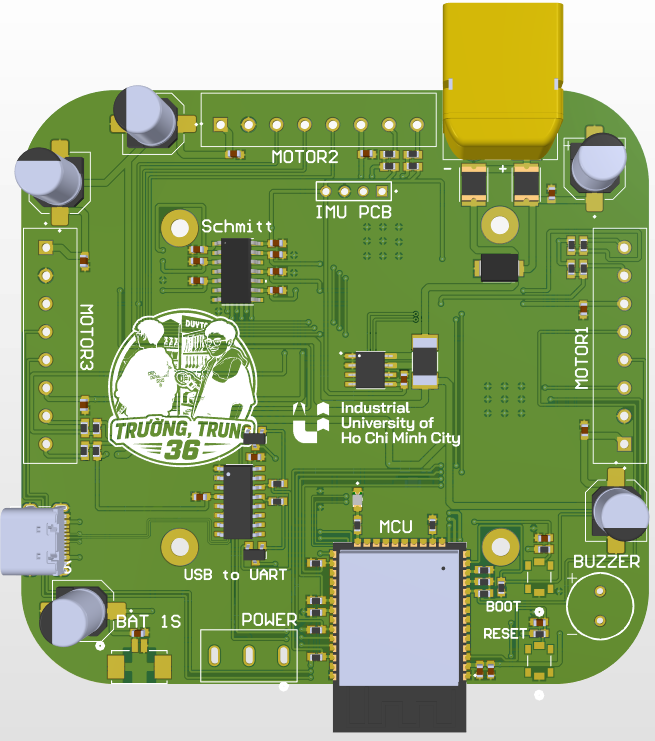
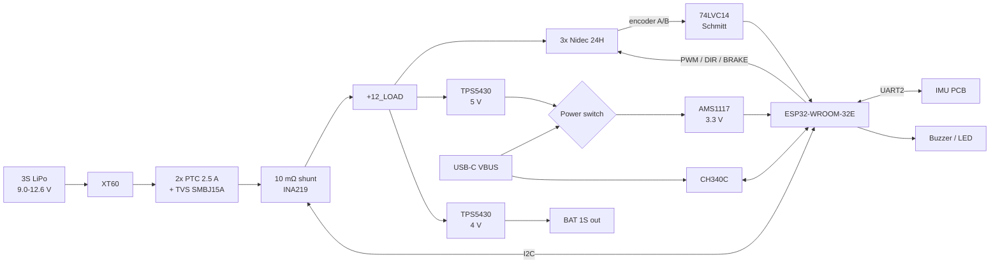
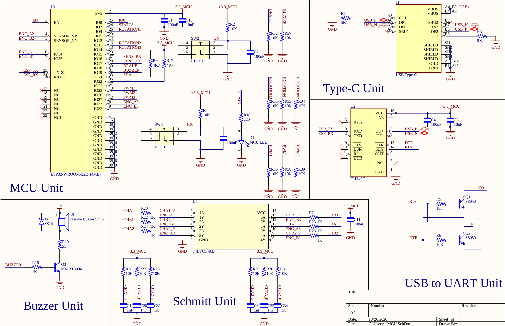
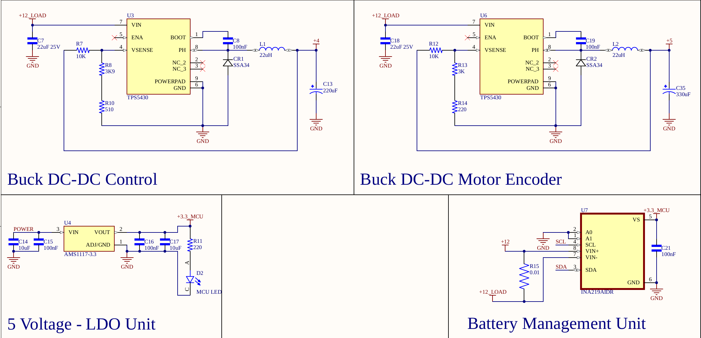
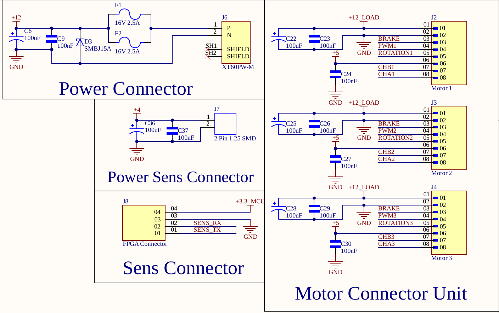

# CubliV2 — ESP32 Reaction-Wheel Self-Balancing Cube

A redesigned control board for a **Cubli**-style self-balancing cube: three reaction wheels driven by
Nidec 24H brushless motors let the cube balance on an edge or on a corner. Inspired by the
ETH Zürich Cubli and RemRC's ESP32 Cubli, this second revision adds proper power conversion, protection, battery
monitoring and encoder signal conditioning.

<p align="center">
  
</p>

| | |
|---|---|
| **Status** | PCB: designed ✅ · Firmware: in progress 🚧 |
| **EDA** | Altium Designer (`hardware/CubliV2.PrjPcb`) |
| **MCU** | ESP32-WROOM-32E (4 MB) |
| **Motors** | 3× Nidec 24H BLDC with integrated driver and 100-line encoder |
| **Battery** | 3S LiPo (9.0–12.6 V) via XT60 |
| **Author** | Tuan — Industrial University of Ho Chi Minh City (IUH) |

---

## Features

- **ESP32-WROOM-32E** with USB-C → CH340C programming and automatic reset/boot.
- **Two TPS5430 3 A buck converters**: 5 V for motor encoders and buzzer, 4 V for an external
  1S-powered sensor board.
- **AMS1117-3.3** logic rail with a 3-position switch: battery / off / USB, so the firmware can be
  developed over USB with no battery attached.
- **INA219** high-side power monitor (10 mΩ shunt) on the whole battery path: pack voltage, current
  and power for low-voltage cut-off and over-current protection.
- **Input protection:** two parallel 2.5 A resettable PTC fuses and an SMBJ15A TVS diode.
- **74LVC14 Schmitt-trigger buffering** with RC filtering on all six encoder channels.
- Separate **IMU PCB** header (UART), passive buzzer, status LED, BOOT/RESET buttons.
- Per-motor bulk and decoupling capacitors directly at each motor connector.

## Block diagram



## Schematic

The full schematic is in [`docs/CubliV2_Schematic.pdf`](docs/CubliV2_Schematic.pdf).

| MCU sheet | Power sheet | Connector sheet |
|---|---|---|
|  |  |  |

## Power rails

| Rail | Regulator | Voltage | Supplies |
|---|---|---|---|
| +12 / +12_LOAD | Battery (fused, TVS, shunt) | 9.0–12.6 V | Motors, buck converters |
| +5 | TPS5430 (U6) | 5.0 V | Encoders, buzzer, logic (battery mode) |
| +4 | TPS5430 (U3) | 4.0 V | `BAT 1S` connector |
| +3.3_MCU | AMS1117-3.3 (U4) | 3.3 V | ESP32, CH340C, 74LVC14, INA219, IMU PCB |

## ESP32 pin map

| Function | Motor 1 | Motor 2 | Motor 3 |
|---|---|---|---|
| PWM (speed) | GPIO25 | GPIO26 | GPIO27 |
| Direction | GPIO4 | GPIO13 | GPIO14 |
| Encoder A | GPIO34 | GPIO36 | GPIO32 |
| Encoder B | GPIO35 | GPIO39 | GPIO33 |
| PCB silkscreen | `MOTOR2` (top) | `MOTOR3` (left) | `MOTOR1` (right) |

| Signal | GPIO | Signal | GPIO |
|---|---|---|---|
| BRAKE (all motors) | 18 | I²C SDA / SCL (INA219 @ 0x40) | 21 / 22 |
| Buzzer | 19 | IMU UART2 RX / TX | 16 / 17 |
| Status LED | 2 | BOOT button | 0 |

> ⚠️ The silkscreen motor numbers differ from the schematic numbers (see table above).
> Firmware uses the schematic numbering. Full details: [`context.md`](context.md).

## Motor wiring (Nidec 24H, 8-wire)

Motor connectors are 8-pin 3.81 mm terminals; pin 1 is the square pad.

| Pin | Wire | Function |
|---|---|---|
| 1 | 🔴 Red | +12 V motor power |
| 2 | ⚫ Black | GND |
| 3 | 🟡 Yellow | Start / brake (HIGH = run, LOW = brake) — shared |
| 4 | ⚪ White | PWM speed, ~20 kHz, inverted (LOW = fast) |
| 5 | 🟢 Green | Direction |
| 6 | 🔵 Blue | Encoder +5 V |
| 7 | 🟣 Purple | Encoder B |
| 8 | 🩶 Grey | Encoder A |

Reverse-engineered from the original motor harness and the vendor wiring note; verify with the
bench test in [`context.md`](context.md#12-bench-bring-up-checklist-before-any-balancing) before
balancing.

## Repository structure

```
CubliV2/
├── hardware/        Altium project: schematics, PCB, libraries
├── manufacturing/   Gerber, NC drill, BOM, DRC/fab reports
├── docs/            Schematic PDF, images, Claude Code prompt
├── firmware/        ESP32 firmware (PlatformIO) — work in progress
├── context.md       Hardware reference for firmware development
└── CLAUDE.md        Entry point for Claude Code
```

## Getting started

### Hardware
1. Open `hardware/CubliV2.PrjPcb` in Altium Designer.
2. Fabrication files are ready in `manufacturing/gerber` and `manufacturing/drill`
   (2-layer board), and the BOM is `manufacturing/bom/CubliV2.xlsx`.

### Firmware (planned)
```bash
cd firmware
pio run -t upload      # flash over USB-C (power switch on USB or battery)
pio device monitor     # CLI + telemetry
```

### First power-up checklist
1. Power from USB only, with no motors connected, and check the 3.3 V rail and the status LED.
2. Connect the 3S pack and measure 5.0 V and 4.0 V. INA219 should read the pack voltage.
3. Connect one motor with the wheel free to spin, then run the bench test commands before balancing.

## Safety

- The motors are **braked at reset** (BRAKE pull-down); firmware keeps them braked until armed.
- Never release the brake before the PWM outputs are at the stop level.
- Low-voltage cut-off at 3.3 V per cell (9.9 V). Do not leave a 3S LiPo connected unattended.
- Spinning reaction wheels store energy, so keep fingers clear while testing.

## Roadmap

- [x] Schematic and PCB (rev 2)
- [ ] Board bring-up and bench-test firmware
- [ ] Attitude estimation from the IMU PCB
- [ ] Edge balancing (single wheel)
- [ ] Corner (vertex) balancing (three wheels)
- [ ] Live tuning and telemetry (USB / Wi-Fi), parameters in NVS, OTA

## Acknowledgements

- M. Gajamohan, R. D'Andrea et al., *The Cubli*, ETH Zürich IDSC.
- RemRC, for the original ESP32 + Nidec 24H Cubli concept.

## License

To be decided (suggested: CERN-OHL-P v2 for hardware, MIT for firmware).
